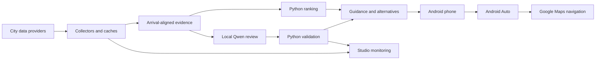

# RideEdge

A local-AI proof of concept: turn changing city information into positioning guidance on an Android phone and in Android Auto.

RideEdge explores a broader pattern for field operations: collect evidence, evaluate it on a recurring schedule on your own computer, validate the model's output, and deliver useful choices where people work. The Seattle rideshare scenario demonstrates that architecture; this is not an Uber dispatch integration or a proven predictor of pickup probability or earnings.

## What is included

- **Android app:** Now, Nearby, Plan, source reports, airport arrivals, and Ask Qwen.
- **Android Auto:** numbered recommendation maps, nearby opportunities and planning, with a user-selected destination handed to Google Maps.
- **Python backend:** provider adapters, caching, eligibility and ranking, structured local Qwen evaluation, validation, access control, and bounded background sessions.
- **Studio dashboard:** source health and provenance, model status, evaluation metrics, and a configurable hosted-token cost comparison.
- **Decision policy:** [`farol/decision_policy.yaml`](farol/decision_policy.yaml) defines review cadence and model instructions. Python enforces eligibility and validates evidence references.
- **Tests, public area catalogs, and explicitly labeled synthetic fixtures.** Recorded footage, personal trips, private capture receipts, signing keys, and model weights are not included.

## How it works



An active planning session schedules another evaluation ten minutes after the preceding evaluation completes. This is bounded session work, not an unconditional all-day loop. When the model or evidence is unavailable, the app reports that condition and can show a labeled deterministic or contextual fallback. The current policy is enabled; historical architecture documents describe earlier stages and should not be mistaken for current runtime settings.

Local inference has **no hosted-model charge per token**. Hardware, electricity, external data APIs, and navigation services still have costs. Processing prompts locally does not make external provider or navigation requests local.

## Start with mock data

Use Python 3.11 or later, from the repository root:

```powershell
python -m venv .venv
.\.venv\Scripts\Activate.ps1
python -m pip install -e ".[api,events,dev]"
Copy-Item .env.example .env
python -m farol.access issue
python -m farol.api
```

The example configuration uses mock feeds and loopback binding. It does not include credentials or start a model server. The access command issues a key locally; keep it private. For browser sign-in and phone access, configure your own HTTPS origin as described in [Setup](docs/SETUP.md). Authentication remains required in mock mode.

## Connect your model and phone

1. Run a compatible Qwen model in a local OpenAI-compatible server. Set `FAROL_LOCAL_MODEL` to its exact served model ID and `FAROL_LOCAL_URL` to its loopback `/v1/chat/completions` endpoint.
2. Keep `FAROL_LOCAL_MANAGE=external` unless you have separately installed and configured a compatible GPU lease coordinator. The original workstation's coordinator and other applications are not part of this repository.
3. Set `RIDEEDGE_PUBLIC_ORIGIN` to your own HTTPS origin and configure private network access/TLS. Keep the backend on loopback behind that proxy.
4. Build the phone app with the same origin, then enter your locally issued access key on its Connection screen.

```powershell
cd android
.\gradlew.bat :app:assembleDebug -PrideedgeOrigin=https://your-host.example.com
```

Android requires JDK 17 and Android SDK 36; the current minimum phone API level is 35. Use Android Studio to install the required SDK tools. `android/` contains the current phone/Android Auto application; `automotive/` is an earlier separate Automotive experiment.

## Enable real providers deliberately

Keep secrets in the ignored `.env`. Provider adapters include event schedules, public transport, roads, weather, places, airport context, and venue activity. An adapter being present does not mean it is currently live, configured, fresh, or used in a recommendation. Source roles and limitations are described in [Architecture](docs/ARCHITECTURE.md).

BestTime is controlled separately by an explicit, bounded allowance. Do not assume enabling live feeds authorizes unlimited paid requests. Google Places supplies place and hours context, not an official live Popular Times feed. No provider exposes actual Uber requests or driver supply to this app.

## Tests and privacy

See [Validation](docs/VALIDATION.md) for the export's test results and intentionally excluded private-data tests. The [publication notes](docs/PUBLICATION.md) explain what was removed and how this repository was prepared.

This repository starts from a sanitized source snapshot. It deliberately does not include the original development Git history. No API key, access key, private hostname, personal trip ledger, recording, or upload signing key is required to read or build the source.
